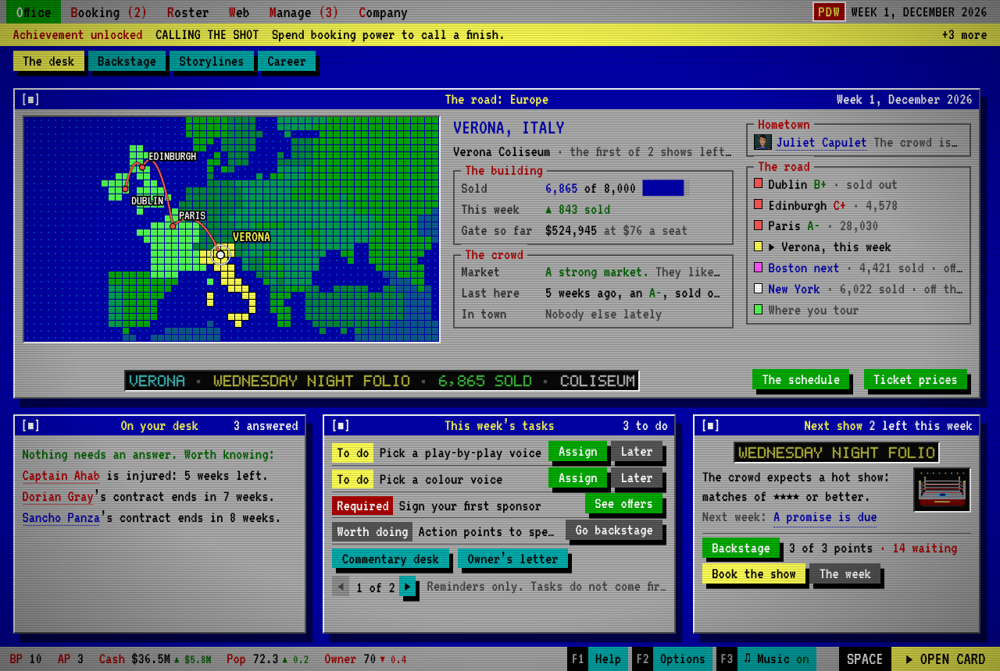
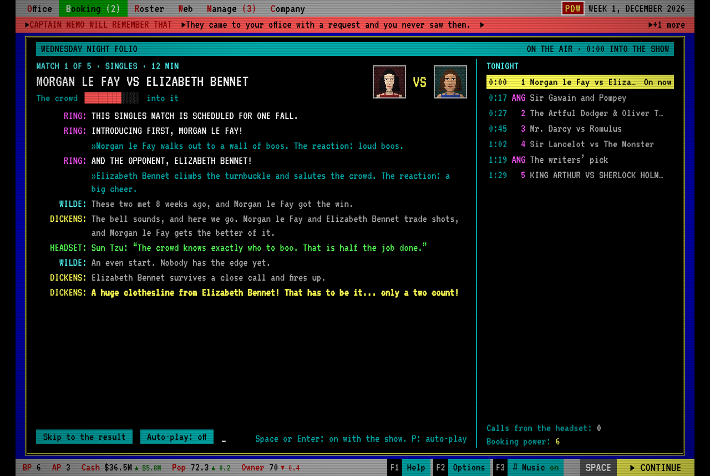
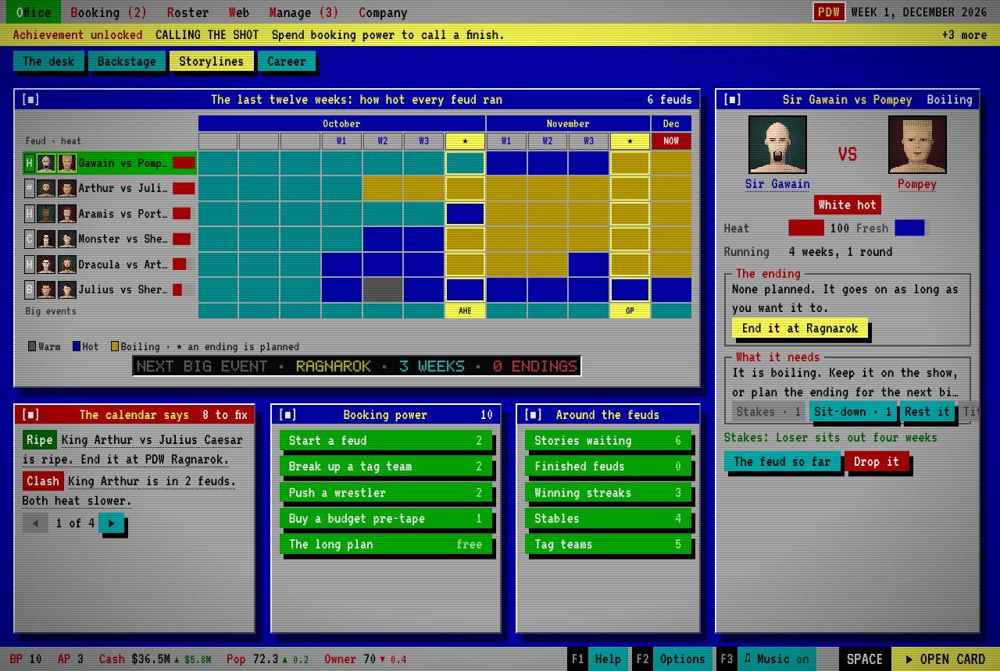
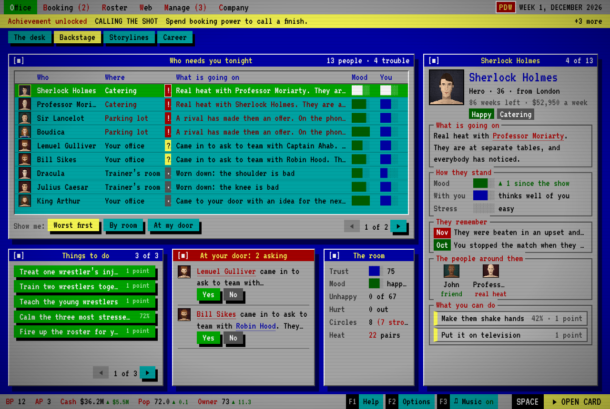
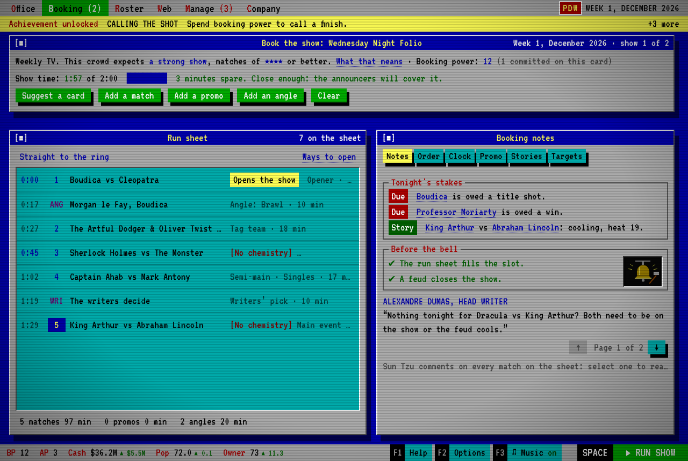
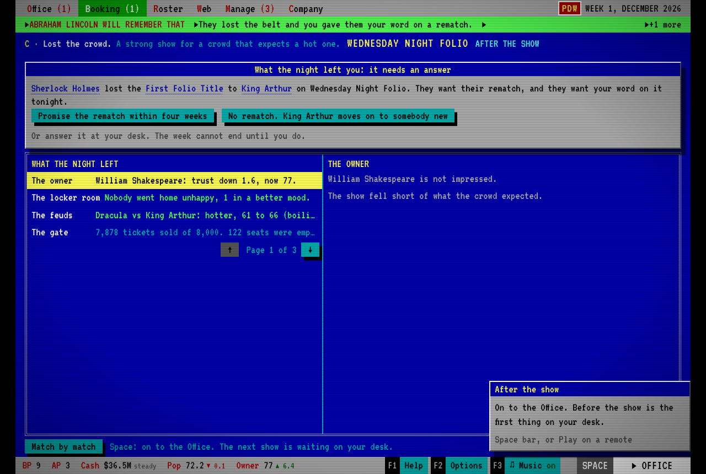
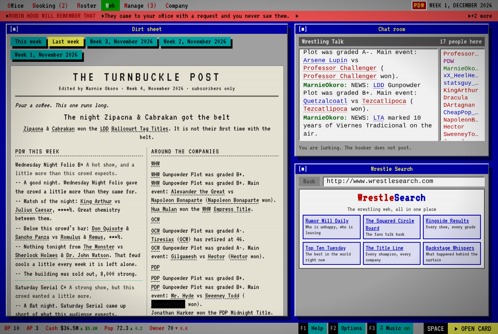
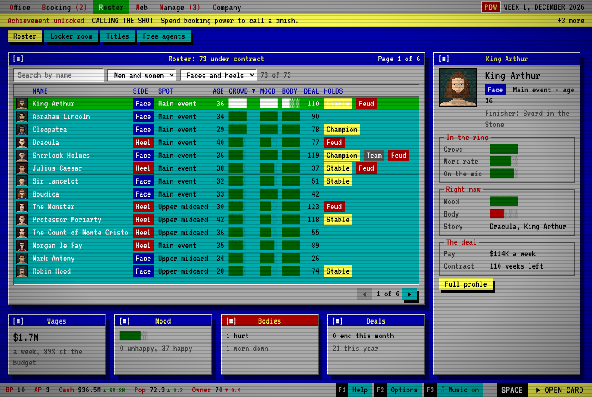
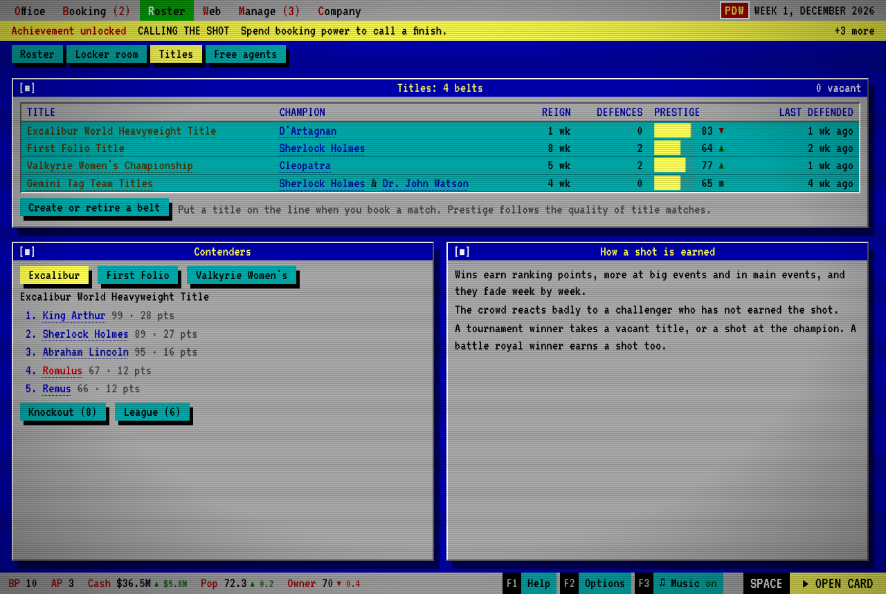

# EWF WRESTLING MANAGER

**Elite Wrestling Federation. You hold the book.**

`Wrestling` `Management` `Simulation` `Text-Based` `Sports` `Singleplayer` `Retro` `Moddable`

**Release:** Coming to Steam &nbsp;|&nbsp; **Version:** 0.79, early access build &nbsp;|&nbsp; **Developer:** Ryan

---

## About this game

You are the booker of a wrestling company, and the owner is watching. Build the card, set the running order, pick who wins, and stand at the gorilla position while the show goes out live. Every call you make, the locker room remembers.

EWF Wrestling Manager is a text-based booking sim drawn as a 1990s PC program: grey windows on a blue desktop, a dot-matrix road map, and a broadcast in scrolling text. It plays on a desk, a tablet or a TV, with a mouse, touch, a keyboard or a gamepad.

There is no clean place to stop. Every show leaves a problem or a chance for next week.

## Screenshots

| | |
|:-:|:-:|
|  |  |
| **Live from the gorilla position.** The show goes out step by step, and the headset calls for an answer. | **Living storylines.** No set lengths. A feud stays hot for a year or never catches on. |
|  |  |
| **Backstage.** Everyone in the building is there for a reason. Spend your points on people. | **Book the show.** The run sheet has to fill the clock, and the road agent says what they can see. |
|  |  |
| **After the show.** A grade against your own crowd, and the matter the night left behind. | **The Web.** A 90s newsletter, a chat room, and six make-believe wrestling sites. |
|  |  |
| **The roster.** Every wrestler has a file, a mood and a history with you. | **Titles.** Lineages, contenders and tournaments. |

## Features

### 🎙️ The show goes out live
Book a promo, an angle or a match and watch it play out on the broadcast. The owner wants a favourite to win. The network says you are running long. Someone is hurt in the ring. The crowd has gone quiet. Every call is yours, and nobody forgets the answer.

### 🔥 Living storylines
Feuds have no set length. Each has **heat** (how much the crowd cares) and **freshness** (how much it still has to give). Promos, brawls, stipulations, contract signings and twists heat it up. Repeating yourself wears it out. End a feud at its peak for the biggest payoff, or watch one that never caught on fizzle away. A cage match needs a hot feud. A mask match needs a white hot one.

### 🧠 Relationships are the centre
Every wrestler remembers how you treated them: promises kept and broken, pushes, losses at home, the day you never saw them. Friends, rivals, jealousy, teachers and students. The game finds stories already hiding in your history and pitches them to you.

### 🗺️ The road
Tour a loop of real cities on a dot-matrix map. Sell tickets weeks ahead, build each market, and bring wrestlers home for a hometown pop.

### ✍️ Words that are never the same twice
Promos, newsletter headlines, website stories and the chat room are written by a text grammar that only says what is true of your game. Every booked promo has a speaker and a callback to real history.

### 🏢 Nine ways to run a company
A publicly traded giant, a company for the diehards, a sport-first purist, an underdog, a cash-burning startup, an outlaw, a lucha spectacle, a lucha traditionalist and an all-women company. Each one changes what the crowd rewards, where the money comes from and who gets pushed. Or found your own.

### 🌐 Fog of war
The game never tells you how a match will go. Your road agent reads what can be seen. Learn your roster show by show.

### 🛠️ Build your own world
The default world is public domain: legends, myth and classic fiction, set in the present day. The World Editor builds a universe from nothing: wrestlers, companies, belts and logos. A world is one shareable file.

### 📜 The long game
Title histories, the greatest feuds, a record book, awards, a hall of fame, ageing and rookie classes, television deals that last for years, and the owner's trust. Earn enough of it and the company becomes yours.

## System requirements

| | Minimum |
|---|---|
| **OS** | Windows, macOS, Linux, or any modern browser |
| **Display** | 1280 by 720, wide screen (desk, tablet or TV) |
| **Input** | Mouse, touch, keyboard, or gamepad |
| **Storage** | Under 10 MB |
| **Network** | None. The game fetches nothing. |

## Play it now

Open `dist/index.html` in any browser. It is one self-contained file: no server, no downloads, no external assets.

---

## Build and test

    cd app && npm ci && cd ..   # installs the interface's build tools
    node build.js          # joins src/*.js into engine.js, bundles app/, writes dist/
    node test-uni.js universes/public_domain.json 60    # plays 60 weeks of every promotion with no interface
    NODE_PATH=<where playwright lives> node app/tests/journey.js    # plays real weeks in a browser on four screen sizes
    NODE_PATH=<where playwright lives> node tools/screenshots.js   # remakes the pictures on this page

## Layout

    src/*.js  -> engine.js    the simulation: no screen code, plain-JSON state, seeded
    app/                      the interface: Preact + TypeScript, bundled by esbuild into one script
    app/addons/               self-contained add-ons appended to the page (the soundtrack)
    universes/                universe packages; tools/ builds the default one
    desktop/                  Electron + steamworks.js wrapper (untested scaffold)
    docs/                     design document, universe format, backlog
    legacy/                   the interface this one replaced, kept for reference
    dist/                     the built game

Start with `docs/design.md`, then `app/DEV.md` for how screens are written.

## Rules the project keeps

- **Zero external assets.** The page fetches nothing. The interface is CSS, the font is embedded, portraits are drawn on a canvas by code.
- **Original content only.** Company models follow how real wrestling companies are run, but every promotion, wrestler and storyline name is invented or public domain. Real-world rosters are not part of this repository.

## Credits

The typeface is VT323 (SIL Open Font License 1.1), embedded in the built page.
